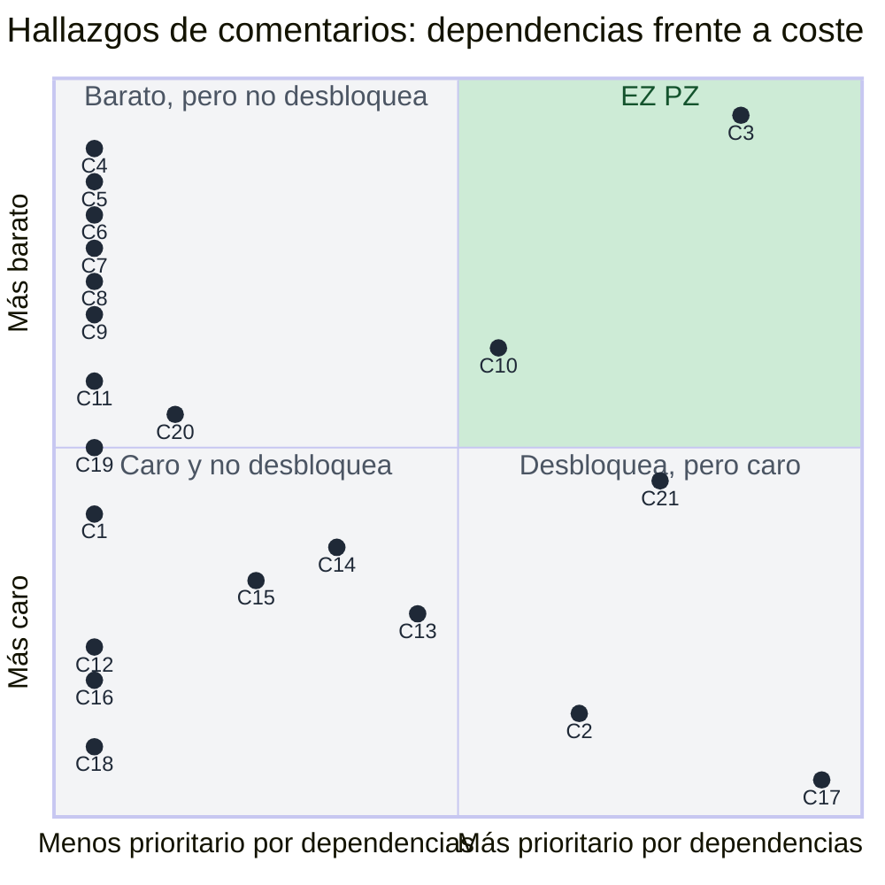

# Auditoría de la feature de comentarios

**Alcance:** las rutas `POST /posts/:slug/comentarios`, `PATCH /comentarios/:id` y
`DELETE /comentarios/:id`; la lista de comentarios del detalle (`GET /posts/:slug`); los recuentos
de comentarios de `GET /posts` y `GET /posts/:slug/relacionados`; la tabla `comentarios`; y lo que
la web enseña de ellos (`Comentarios.jsx` y el recuento de `DetallePost.jsx`).

**Qué se busca:** bugs, debilidades, seguridad y reglas de negocio. Los incumplimientos de la
arquitectura objetivo del `CLAUDE.md` quedan fuera a propósito.

**Cómo se ha comprobado:** leyendo el código y con consultas `SELECT` de solo lectura a
`backend/tmp/db.sqlite3`, la base sembrada. La API no se ha levantado, así que ninguna fila se ha
comprobado con una petición HTTP real. Cuando una fila se apoya en datos de la base, lo dice.

**Orden:** las filas van por capas (API, base de datos, web), **no por prioridad**. La priorización
se hace después. El `ID` solo sirve para que la casilla 6 pueda nombrar a otros hallazgos. La
sección «Prioridad por dependencias», debajo de la tabla, las ordena solo según la casilla 6, y
«Prioridad por coste» las ordena según las casillas 4 y 5.

## Hallazgos

| ID | 1. Qué es | 2. Dónde está | 3. Qué se rompe y quién lo nota | 4. Sitios a tocar | 5. ¿Reversible con un revert? | 6. ¿Bloquea o desbloquea a otro? |
|---|---|---|---|---|---|---|
| **C1** | La clave de moderación que permite borrar cualquier comentario está escrita en el código fuente. | `backend/start/routes.ts:25` `const SECRETO_SESION = 'dev-secret-cambiar'` `backend/start/routes.ts:351` `const esModerador = clave === SECRETO_SESION` | Cualquiera que lea el repositorio o su historial puede borrar cualquier comentario enviando `x-clave-moderacion: dev-secret-cambiar`. Lo notarían quienes comentan, al ver desaparecer sus comentarios. Hoy no lo nota nadie, mientras no esté desplegado. El comentario de `routes.ts:21` dice que esa clave también firma las sesiones, pero no se usa en ningún otro sitio: las sesiones usan `APP_KEY` (`start/env.ts:22`). | **4:** `routes.ts:25`, `routes.ts:351`, `start/env.ts` (declarar la variable, después de la línea 26) y `.env.example` (documentarla). Uno más, `backend/.env.test`, si algún test necesita la clave. | **El código sí.** Pero la clave ya está en el historial de git, así que el arreglo exige rotarla, y un revert devolvería al código la clave filtrada. | A ninguno. |
| **C2** | `DELETE` y `PATCH` deciden quién es el autor de un comentario solo por el correo que viene en la petición. | `backend/start/routes.ts:350-353` `const email = request.input('autor_email', '')` … `String(comentario.autor_email).toLowerCase().trim() === String(email).toLowerCase().trim()` `backend/start/routes.ts:379` `if (comentario.autor_email !== email \|\| comentario.estado !== 'pendiente')` | Cualquiera que conozca el correo de quien comentó puede borrar su comentario, o editarlo si sigue pendiente. Lo notarían quienes comentan. Hoy nadie, porque la web no ofrece ni borrar ni editar (`Comentarios.jsx` no tiene esas acciones). | **2:** `routes.ts:352-353` y `routes.ts:379`. Además, el mecanismo de identidad que los sustituya, que es una decisión de producto y aún no se puede contar. | **Sí**, si el arreglo es solo código. **No**, si guarda un token por comentario: haría falta una migración, y un revert del código no deshace la migración ya aplicada. | **C3 lo agrava:** hace públicos los correos que bastan para borrar. Arreglar C2 hace que C10 deje de importar. |
| **C3** | El detalle de un post devuelve el correo de cada persona que comenta, e incumple la regla 6. | `backend/start/routes.ts:153` `"select * from comentarios where post_id = ? and estado = 'aprobado' order by creado_en asc"` `backend/start/routes.ts:171` `comentarios: comentarios,` | Cualquier visitante ve el `autor_email` de los comentarios aprobados abriendo las herramientas del navegador. Les afecta a quienes comentan. **Comprobado en la base:** hoy son 4 correos (comentarios 1, 2, 6 y 8), entre ellos el de la autora `marta.ruiz@corriente.es`. | **1:** `routes.ts:153`, cambiando `select *` por las columnas que hacen falta. La web no usa `autor_email` (`Comentarios.jsx:56-71` lee `id`, `padre_id`, `autor_nombre`, `creado_en` y `cuerpo`), así que quitarlo no la rompe. | **Sí.** | **Desbloquea parte de C2**, porque deja de servir los correos que bastan para borrar. |
| **C4** | `POST` responde con el último comentario de toda la tabla, no con el que acaba de insertar. | `backend/start/routes.ts:329-331` `'select * from comentarios order by id desc limit 1'` | Si llegan dos `POST` casi a la vez, uno puede recibir el comentario del otro, con su correo y su cuerpo. Lo notaría quien comenta. Hoy nadie, por el poco tráfico. **No se ha verificado en ejecución.** | **1:** `routes.ts:329-331` (usar el id del insert). | **Sí.** | A ninguno. |
| **C5** | Un comentario con el cuerpo demasiado corto responde `200` en lugar de un error. | `backend/start/routes.ts:319-320` `if (!cuerpo \|\| String(cuerpo).length < 5) {` `return response.send({ ok: false, motivo: 'comentario demasiado corto' })` | Un cliente de la API que mire el código HTTP cree que el comentario se ha creado. La web no lo nota: `Comentarios.jsx:37` mira `d.comentario` y `:44` enseña `motivo`. No sé si existen otros clientes. | **1:** `routes.ts:320`. | **Sí.** | A ninguno. |
| **C6** | El error de correo inválido viene en un campo (`errores`) que la web no lee. | `backend/start/routes.ts:317` `return response.status(400).send({ errores: ['email no válido'] })` `frontend/src/componentes/Comentarios.jsx:44` `setAviso(d.error \|\| d.message \|\| d.motivo \|\| 'No se ha podido enviar.')` | Quien escribe un correo sin `@` ve «No se ha podido enviar.» en lugar del motivo. Lo notan los lectores que comentan. | **1:** `routes.ts:317` o `Comentarios.jsx:44`, uno de los dos. | **Sí.** | A ninguno. |
| **C7** | La validación del correo solo comprueba que contenga `@`. | `backend/start/routes.ts:316` `if (String(email).indexOf('@') === -1) {` | Se aceptan correos como `@` o `a@`. Lo notarían los moderadores, porque no pueden contactar con quien comenta. Hoy nadie. | **1:** `routes.ts:316`. | **Sí.** Los datos que ya existen no cambian. | A ninguno. |
| **C8** | El cuerpo solo se valida con una longitud mínima de 5 caracteres, sin recortar espacios y sin máximo, y nombre y correo no tienen límite de longitud. | `backend/start/routes.ts:319` `if (!cuerpo \|\| String(cuerpo).length < 5) {` `backend/database/migrations/1769000000005_create_comentarios_table.ts:15-17` `table.string(...)` / `table.text('cuerpo')`: SQLite no hace cumplir la longitud de `varchar`. | Un cuerpo de cinco espacios pasa, y uno de varios megas también. Lo notarían los moderadores, que reciben basura. Hoy nadie. | **1:** `routes.ts:310-321`, el bloque de validación. | **Sí.** | A ninguno. |
| **C9** | `PATCH` no aplica al cuerpo la longitud mínima que sí exige `POST`. | `backend/start/routes.ts:384` `if (!cuerpo) {`, frente a `routes.ts:319` `String(cuerpo).length < 5` | Un comentario pendiente puede editarse a un solo carácter. Hoy nadie, porque la web no permite editar. | **1:** `routes.ts:384`. | **Sí.** | A ninguno. |
| **C10** | `PATCH` compara el correo distinguiendo mayúsculas y espacios, mientras que `DELETE` los ignora. | `backend/start/routes.ts:379` `comentario.autor_email !== email`, frente a `routes.ts:353` `.toLowerCase().trim()` | Quien escribe su correo con otra capitalización puede borrar su comentario pero no editarlo. Hoy nadie, porque la web no permite ninguna de las dos cosas. | **1:** `routes.ts:379`. | **Sí.** | **Depende de C2:** si C2 cambia el mecanismo de identidad, C10 desaparece. |
| **C11** | `POST` acepta cualquier `padre_id` sin comprobar que exista ni que pertenezca al mismo post. | `backend/start/routes.ts:308` `const padre = request.input('padre_id', null)` `backend/start/routes.ts:326` `[post.id, nombre, email, cuerpo, 'pendiente', creado, padre]` | Una respuesta colgada de un padre que no existe, o que es de otro post, no se pinta nunca en la web aunque se apruebe (véase C19). Hoy nadie, porque la web no envía `padre_id` (`Comentarios.jsx:33`). | **1:** `routes.ts:308`. | **Sí.** | **Se solapa con C18:** una clave foránea en `padre_id` cubriría los padres inexistentes, pero no los de otro post. |
| **C12** | Borrar un comentario deja sus respuestas huérfanas. | `backend/start/routes.ts:359` `await db.rawQuery('delete from comentarios where id = ?', [params.id])` | Las respuestas siguen en la base y se cuentan (`routes.ts:75`, `DetallePost.jsx:38`), pero la web deja de pintarlas (C19). **Comprobado en la base:** si se borra el comentario 1, el 2 (respuesta aprobada de Marta Ruiz) deja de verse. Lo notarían lectores y quien respondió. Hoy nadie. | **1:** `routes.ts:359`. Falta decidir qué se hace con las respuestas, que es decisión de producto. | **Sí**, si el arreglo es código. **No**, si se resuelve con un `ON DELETE CASCADE` en una migración (véase C18). | **Se relaciona con C18 y C19:** arreglar C19 mitiga C12. |
| **C13** | No hay ningún endpoint que apruebe un comentario: todos nacen `pendiente` y ninguna ruta cambia su `estado`. | `backend/start/routes.ts:326` inserta `'pendiente'`. El único `update` es `routes.ts:388` `'update comentarios set cuerpo = ? where id = ?'`, que solo cambia el cuerpo. | Desde la API, un comentario nuevo no llega a verse nunca. Lo notan quienes comentan. **No he podido comprobar** si hoy se modera a mano en la base o con alguna herramienta externa. | **1** ruta nueva, en `routes.ts`. | **Sí.** | **Bloqueado por C17:** antes de escribir el estado hay que decidir qué valores son válidos. |
| **C14** | El detalle esconde los comentarios aprobados que tienen el estado escrito como `'Aprobado'` o `'ok'`. | `backend/start/routes.ts:153` `estado = 'aprobado'` (el comentario de `routes.ts:150-151` ya lo admite) | **Comprobado en la base:** 3 comentarios aprobados no se ven, el 3 y el 4 del post 1 y el 9 del post 6. Lo notan los lectores y quienes los escribieron (Rubén Lima, Silvia Peña y Paula Merino). | **1:** `routes.ts:153`, si se arregla en el código. **0** en el código, si se arregla normalizando los datos (C17). | **Sí**, si se arregla en el código. | **Bloqueado por C17:** hay que decidir si `'ok'` cuenta como aprobado. |
| **C15** | Los recuentos de comentarios cuentan todo lo que no está pendiente, no solo lo aprobado, e incumplen la regla 5. | `backend/start/routes.ts:75-76` `c.estado <> ' + "'pendiente')` `backend/start/routes.ts:223` `estado <> 'pendiente'` | **Comprobado en la base:** el listado dice que el post 1 tiene 4 comentarios y el detalle enseña 2, y el post 6 dice 1 y enseña 0. Cualquier estado futuro (`'rechazado'`, `'spam'`) también contaría. Lo notan los lectores, en `ListaPosts.jsx:57` y `PostsRelacionados.jsx:32`. | **2:** `routes.ts:75-76` y `routes.ts:223`. | **Sí.** | **Bloqueado por C17**, por la misma decisión que C14. |
| **C16** | `POST` no tiene ningún límite de envíos ni protección contra el spam. | `backend/start/routes.ts:295` `router.post('/posts/:slug/comentarios', async (...)`, sin `.use(...)`, frente a `routes.ts:416` `.use(middleware.auth())`. `@adonisjs/limiter` no está en `backend/package.json`. | Un script puede crear comentarios sin límite. Lo notan los moderadores. **En la semilla** ya hay un comentario de spam pendiente (el 7, «Comercial de plantillas»). | `routes.ts:295` y `backend/package.json`, más los archivos que genere `node ace add @adonisjs/limiter`. **Estos no se han contado**, porque dependen del CLI. | **Sí**, salvo si el limitador guarda su estado en tablas de la base: entonces hay una migración. | A ninguno. |
| **C17** | `comentarios.estado` es texto libre, sin `CHECK` ni enum, y ya conviven cuatro valores. | `backend/database/migrations/1769000000005_create_comentarios_table.ts:18` `table.string('estado').notNullable().defaultTo('pendiente')` `backend/database/seeders/blog_seeder.ts:510`, `:522`, `:575` (`'Aprobado'`, `'ok'`, `'Aprobado'`) | Es la causa de C14 y de C15. **Comprobado en la base:** `aprobado` 4, `Aprobado` 2, `ok` 1, `pendiente` 2. Lo notan los lectores, a través de C14 y C15. | **1** migración nueva, que normalice los datos y añada el `CHECK`, más **3** líneas de la semilla (`blog_seeder.ts:510`, `:522` y `:575`). | **No.** Normalizar los datos borra la diferencia entre `'Aprobado'`, `'ok'` y `'aprobado'`, y el `down()` no puede saber qué valor tenía cada fila. Además, en SQLite un `CHECK` obliga a recrear la tabla. | **Desbloquea C13, C14 y C15.** |
| **C18** | `post_id` y `padre_id` no tienen clave foránea, y `post_id` no tiene índice. | `backend/database/migrations/1769000000005_create_comentarios_table.ts:14` `table.integer('post_id').notNullable()` `…:20` `table.integer('padre_id').nullable()` | Si se borrara un post, sus comentarios quedarían huérfanos. Hoy no hay ninguna ruta que borre posts, y en la base hay 0 huérfanos (**comprobado**). Sin índice, cada recuento por post (`routes.ts:75`) recorre la tabla entera. Hoy nadie lo nota, con 9 filas. | **1** migración nueva. | **No con un revert solo:** hay que hacer el rollback de la migración. En SQLite, añadir una clave foránea obliga a recrear la tabla. | **Se solapa con C11 y C12.** |
| **C19** | La web solo pinta los comentarios raíz y sus respuestas directas, así que cualquier respuesta cuyo padre no esté en la lista desaparece, aunque esté aprobada. | `frontend/src/componentes/Comentarios.jsx:50` `const raices = comentarios.filter((c) => !c.padre_id)` `Comentarios.jsx:63-64` `.filter((r) => r.padre_id === c.id)` | Esa respuesta no se ve, pero sí se cuenta (`Comentarios.jsx:23`, `DetallePost.jsx:38`). Pasa cuando el padre está pendiente, cuando se escribió `'Aprobado'` (C14), cuando se borró (C12), cuando no existe (C11) o cuando es una respuesta a otra respuesta. Hoy nadie: **en la semilla** la única respuesta (la 2) tiene el padre visible. | **2:** `Comentarios.jsx:50` y `Comentarios.jsx:63-64`. | **Sí.** | **Es el efecto visible de C11, C12 y C14.** |
| **C20** | El contador de la sección de comentarios suma uno al enviar, aunque el comentario quede pendiente y no se vea. | `frontend/src/componentes/Comentarios.jsx:39` `setTotal(total + 1)` | Justo después de comentar, la sección dice N+1 comentarios, enseña N, y la cabecera (`DetallePost.jsx:71`) sigue en N. Lo nota quien acaba de comentar. | **1:** `Comentarios.jsx:39`. | **Sí.** | **C21 es su causa de fondo:** dos componentes guardan cada uno su propio recuento. |
| **C21** | La web pide el post entero dos veces para enseñar una página: una para el artículo y otra solo para los comentarios. | `frontend/src/componentes/DetallePost.jsx:34` `fetch(API + '/posts/' + encodeURIComponent(slug))` `frontend/src/componentes/Comentarios.jsx:19` `fetch(API + '/posts/' + encodeURIComponent(slug))` | Hace el doble de peticiones al detalle, y cada componente guarda su propio recuento (`DetallePost.jsx:30`, `Comentarios.jsx:11`). Nadie lo nota todavía, salvo en C20. | **2:** `DetallePost.jsx:34` y `Comentarios.jsx:17-26`. | **Sí.** | **Desbloquea C20**, porque con una sola fuente de datos hay un solo recuento. |

## Prioridad por dependencias

**Criterio:** el orden sale única y exclusivamente de la casilla 6, sin tener en cuenta la gravedad
ni el esfuerzo:

1. Un hallazgo que bloquea a otros va antes que los que bloquea.
2. Entre los que bloquean, va antes el que desbloquea más hallazgos, contando también los que
   desbloquea de forma indirecta.
3. Cuando empatan, van por `ID`.

Solo cuentan los bloqueos («bloquea», «desbloquea», «depende de»). Los solapamientos
(C11↔C18, C12↔C18) y las relaciones de efecto o de mitigación (C19 respecto a C11, C12 y C14)
no son bloqueos y no ordenan nada.

**Los bloqueos que hay:**

- C17 → C13, C14 y C15
- C3 → C2 → C10 (C3 desbloquea C2 solo en parte)
- C21 → C20

### Nivel 1: desbloquean a otros, y ninguno los bloquea

| Posición | Hallazgo | Desbloquea |
|---|---|---|
| 1 | **C17**: `estado` es texto libre | 3: C13, C14 y C15 |
| 2 | **C3**: el detalle devuelve el correo de quien comenta | 2: C2 en parte y, a través de C2, C10 |
| 3 | **C21**: la web pide dos veces el post | 1: C20 |

### Nivel 2: bloqueados, pero desbloquean a otros

| Posición | Hallazgo | Espera a | Desbloquea |
|---|---|---|---|
| 4 | **C2**: autorización solo por correo | C3 (en parte) | 1: C10 |

### Nivel 3: bloqueados que no desbloquean a nadie

| Posición | Hallazgo | Espera a |
|---|---|---|
| 5 | **C10**: `PATCH` distingue mayúsculas en el correo | C2 |
| 6 | **C13**: no hay ningún endpoint para aprobar comentarios | C17 |
| 7 | **C14**: el detalle esconde `'Aprobado'` y `'ok'` | C17 |
| 8 | **C15**: los recuentos cuentan todo lo que no está pendiente | C17 |
| 9 | **C20**: el contador suma uno al enviar | C21 |

### Sin dependencias: empatados

No bloquean ni están bloqueados. Las dependencias no dicen nada de su orden, así que van por `ID`
y empatan entre ellos. Se pueden atacar en cualquier momento y en paralelo con los niveles
anteriores.

C1, C4, C5, C6, C7, C8, C9, C11, C12, C16, C18 y C19.

## Prioridad por coste

**Criterio:** el coste de arreglar cada hallazgo **por separado**, ordenado de más barato a más
caro. Sale solo de las casillas 4 (sitios a tocar) y 5 (reversibilidad). No tiene en cuenta ni la
gravedad ni las dependencias, y no son horas estimadas. Se aplica por este orden:

1. **Reversibilidad.** Si el arreglo no se deshace con un revert, es más caro.
2. **Incertidumbre.** Es más caro si hay sitios sin contar o si falta una decisión de producto
   abierta, como el mecanismo de identidad o qué se hace con las respuestas.
3. **Sitios contados.** Cuantos menos, más barato. Una ruta nueva cuesta más que cambiar una línea.
4. **Empate:** por `ID`.

Un arreglo barato no siempre compensa: C10, por ejemplo, desaparece si se arregla C2. Para eso
está la lista anterior.

### Nivel 1: reversible, con todos los sitios contados y sin ninguna decisión pendiente

| Posición | Hallazgo | Sitios |
|---|---|---|
| 1 | **C3**: el detalle devuelve el correo de quien comenta | 1 |
| 2 | **C4**: `POST` responde con el último comentario de la tabla | 1 |
| 3 | **C5**: un cuerpo corto responde `200` | 1 |
| 4 | **C6**: la web no lee el campo `errores` | 1 |
| 5 | **C7**: el correo solo se valida buscando `@` | 1 |
| 6 | **C8**: validación laxa de cuerpo, nombre y correo | 1 (bloque `routes.ts:310-321`) |
| 7 | **C9**: `PATCH` no exige la longitud mínima | 1 |
| 8 | **C10**: `PATCH` distingue mayúsculas en el correo | 1 |
| 9 | **C11**: `padre_id` no se valida | 1 |
| 10 | **C20**: el contador suma uno al enviar | 1 |
| 11 | **C19**: la web no pinta las respuestas cuyo padre no está en la lista | 2 |
| 12 | **C21**: la web pide dos veces el post | 2 |
| 13 | **C1**: la clave de moderación está en el código | 4, más rotar la clave. Un revert devolvería la clave filtrada. |

### Nivel 2: reversible, pero espera una decisión acotada (qué valores de `estado` son válidos)

| Posición | Hallazgo | Sitios |
|---|---|---|
| 14 | **C14**: el detalle esconde `'Aprobado'` y `'ok'` | 1 |
| 15 | **C15**: los recuentos cuentan todo lo que no está pendiente | 2 |
| 16 | **C13**: no hay ningún endpoint para aprobar comentarios | 1 ruta nueva |

### Nivel 3: hay sitios sin contar o una decisión de producto abierta

| Posición | Hallazgo | Sitios | Lo que lo encarece |
|---|---|---|---|
| 17 | **C12**: borrar deja las respuestas huérfanas | 1 | Hay que decidir qué pasa con las respuestas. Si se resuelve con un `ON DELETE CASCADE`, deja de ser reversible. |
| 18 | **C16**: no hay límite de envíos | 2, más los archivos que genere el CLI (sin contar) | Es un paquete nuevo, y puede llevar una migración. |
| 19 | **C2**: autorización solo por correo | 2, más el mecanismo de identidad (sin contar) | Hay que decidir el mecanismo de identidad, y puede llevar una migración. |

### Nivel 4: no se deshacen con un revert

| Posición | Hallazgo | Sitios | Lo que lo encarece |
|---|---|---|---|
| 20 | **C18**: sin clave foránea ni índice | 1 migración | Hay que hacer el rollback de la migración, y en SQLite hay que recrear la tabla. |
| 21 | **C17**: `estado` es texto libre | 1 migración y 3 líneas de la semilla | Normalizar destruye los valores originales, y en SQLite hay que recrear la tabla. |

## Mapa: dependencias frente a coste

Este gráfico cruza las dos listas anteriores:

- **Eje horizontal:** la prioridad por dependencias. Cuanto más a la derecha, más prioritario.
- **Eje vertical:** la prioridad por coste. Cuanto más arriba, más barato y, por tanto, más
  prioritario.

Cada eje es la posición del hallazgo en su lista, pasada a una escala de 0 a 1. Los 12 hallazgos
que empatan en «Sin dependencias» comparten la última posición de dependencias (10), y por eso
forman la columna de la izquierda.

El cuadrante **EZ PZ** (arriba a la derecha) reúne lo que es prioritario por los dos criterios.

**Dentro de EZ PZ quedan C3 y C10.** Sin embargo, C10 desaparece si se arregla C2 (véase
«Prioridad por dependencias»). C21 se queda justo por debajo de la línea, en la posición 12 de
coste.

### Qué cuadrante va después de EZ PZ, y cuándo partir un hallazgo

**Después de EZ PZ** no va ninguno de los dos cuadrantes entero, sino **la parte barata de los
que desbloquean**. El motivo: lo que solo es barato no gana ni pierde valor si se hace antes o
después, pero lo que desbloquea ahorra trabajo repetido. Por ejemplo, si se arregla C14 en el
código y después se normalizan los datos por C17, C14 se hace dos veces. El orden queda así:

1. **EZ PZ:** C3. C10 puede esperar a ver qué pasa con C2, porque si no, quizá se hace para nada.
2. **La parte barata de «Desbloquea, pero caro»:** la decisión sobre `estado` (C17), y C21.
3. **«Barato, pero no desbloquea»:** C4 a C9, C11 y C20, más C14 y C15, que ya están desbloqueados.
4. **Lo caro y lo que no se puede revertir:** la migración de C17, el mecanismo de identidad de C2,
   y C18.

**Cuándo se parte un hallazgo de «Desbloquea, pero caro»:** se decide hallazgo por hallazgo, no
por cuadrante. Solo se parte si se cumplen dos condiciones:

1. Una parte es barata y reversible y, por sí sola, ya desbloquea a otros o contiene el daño.
2. Esa parte es **compatible** con el arreglo definitivo, es decir, no hay que deshacerla
   después. Si la contención se tira al llegar el arreglo, vuelve el trabajo repetido.

**Cómo queda cada uno:**

| Hallazgo | ¿Se parte? | Cómo |
|---|---|---|
| **C17** | Sí, en tres partes | **1. Decisión:** qué valores de `estado` son válidos. No cuesta código y es lo que desbloquea C13, C14 y C15. **2. Contención:** C14 y C15 leen los valores decididos. Sigue siendo correcta cuando los datos estén normalizados. **3. Arreglo:** la migración que normaliza y añade el `CHECK`, que no se puede revertir. |
| **C2** | Ya está partido | La contención es **C3**, que deja de publicar los correos que bastan para borrar. El arreglo es el mecanismo de identidad: caro, y una decisión de producto. |
| **C21** | No | Es atómico: 2 sitios, reversible. Solo cae en ese cuadrante porque queda justo debajo de la línea. |

**Esto no es exclusivo de ese cuadrante.** C1 («caro y no desbloquea») también se parte:

- **Contención:** rotar la clave y sacarla a una variable de entorno, que son los 4 sitios de su
  fila.
- **Arreglo:** una autorización de moderador de verdad.

**Advertencia:** el gráfico no mide la gravedad. Si la gravedad entra en la priorización, C1, que
es de seguridad, sube bastante.

Los hallazgos **no** se han partido en la tabla. Si se partieran, cada parte sería una fila
propia, y las dos listas y el gráfico cambiarían.

**Los datos del gráfico, en tabla:**

| Hallazgo | Posición por dependencias | Posición por coste | ¿EZ PZ? |
|---|---|---|---|
| C1 | 10 (empate) | 13 |  |
| C2 | 4 | 19 |  |
| C3 | 2 | 1 | **sí** |
| C4 | 10 (empate) | 2 |  |
| C5 | 10 (empate) | 3 |  |
| C6 | 10 (empate) | 4 |  |
| C7 | 10 (empate) | 5 |  |
| C8 | 10 (empate) | 6 |  |
| C9 | 10 (empate) | 7 |  |
| C10 | 5 | 8 | **sí** |
| C11 | 10 (empate) | 9 |  |
| C12 | 10 (empate) | 17 |  |
| C13 | 6 | 16 |  |
| C14 | 7 | 14 |  |
| C15 | 8 | 15 |  |
| C16 | 10 (empate) | 18 |  |
| C17 | 1 | 21 |  |
| C18 | 10 (empate) | 20 |  |
| C19 | 10 (empate) | 11 |  |
| C20 | 9 | 10 |  |
| C21 | 3 | 12 |  |

## Comprobado y descartado

Estas cosas se han mirado y no son hallazgos. Se dejan aquí para que no se vuelvan a buscar:

- **Inyección SQL:** todas las consultas de la feature usan parámetros `?` (`routes.ts:296-393`).
- **XSS en la web:** `Comentarios.jsx` pinta `cuerpo` y `autor_nombre` como texto de JSX, que React
  escapa. No hay `dangerouslySetInnerHTML`.
- **Regla 2 (comentario pendiente oculto en el detalle):** se cumple (`routes.ts:153`).
- **Comentar en un post en borrador:** devuelve 404 (`routes.ts:297` filtra `estado = 'publicado'`).
- **`PATCH` solo deja editar comentarios pendientes** (`routes.ts:379`): no hay ninguna regla
  escrita al respecto, y tiene sentido, porque impide cambiar un texto después de aprobarlo. No se
  trata como bug.

## Parte B

<!-- La rellena la persona que hace el ejercicio. -->

1. El agente ha encontrado 21 hallazgos. Yo he comprobado 5, aunque 1 de ellos ha sido demasiado complejo de comprobar.
2. C2 no se puede priorizar tan fácilmente. Huele a que se trata de uno de esos casos donde hay que partirlo en dos: la contención y el arreglo, porque tiene una dependencia de C3. Según el agente, sería el cuarto hallazgo en prioridad basado en dependencias, y C3 ya estaría resuelto, así que a lo mejor no haría la partición de contención y arreglo.
3. C4 habría que verificarlo en ejecución, y además, haciendo dos POST quasisimultáneos. Supongo que podría comprobarlo a mano, pero es bastante trabajo para auditar una posible corrección que no debería tener efectos secundarios. Además, el SQL Request es poco correcto para la lógica de negocio, así que no tiene sentido no corregirlo.

<!-- Borrador redactado por el agente a petición mía. Pendiente de reescribir. -->
**Razonamiento sobre partir hallazgos.** Después de EZ PZ, no haría ni todo el cuadrante «Barato,
pero no desbloquea» ni todo «Desbloquea, pero caro». Haría primero la parte barata de los que
desbloquean, porque lo que solo es barato no gana ni pierde valor según cuándo se haga, y lo que
desbloquea ahorra trabajo repetido.

Partir un hallazgo en contención y arreglo solo me compensa cuando la contención es barata,
reversible y compatible con el arreglo definitivo. Si hay que deshacerla después, no me ahorra
nada. Por eso partiría C17 en tres: la decisión de qué valores de `estado` son válidos (es lo que
desbloquea), la contención en lectura (C14 y C15) y la migración. Partiría C1 en dos: rotar la
clave y sacarla a una variable de entorno, y después una autorización de moderador de verdad. C2
ya está partido en la práctica, porque su contención es C3. C21 no lo partiría, porque es atómico.
