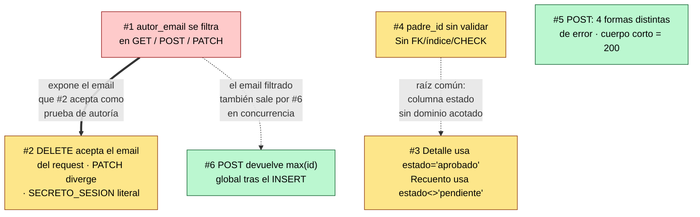

## PARTE A

# Auditoría de la feature `/comentarios`

Alcance: `POST /posts/:slug/comentarios`, `DELETE /comentarios/:id`, `PATCH /comentarios/:id`, los comentarios embebidos en `GET /posts/:slug`, los `num_comentarios` de `GET /posts` y `GET /posts/:slug/relacionados`, la tabla `comentarios` y los componentes React que los pintan.

Columna "Repro" = ¿se puede caracterizar hoy con un test funcional contra la API + semilla actuales? Sin juicio de severidad y sin tocar código.

| # | Qué es | Dónde | Qué se rompe / quién lo nota | Sitios a tocar | Repro | Bloquea / desbloquea |
|---|---|---|---|---|---|---|
| 1 | `autor_email` sale en todas las respuestas de comentarios (`select *`). | GET detalle [`routes.ts:152`](../../backend/start/routes.ts) · POST [`routes.ts:329`](../../backend/start/routes.ts) · PATCH [`routes.ts:388`](../../backend/start/routes.ts) | Correo privado en cada JSON público. El front no lo pinta; DevTools/scraper sí. Viola el contrato de CLAUDE.md. | 3 respuestas + 1 transformer nuevo (no existe `comentario_transformer.ts`). | Sí: `assert.notProperty(cuerpo.comentarios[0], 'autor_email')` falla hoy. | Desbloquea el **2** (le da el email al atacante). |
| 2 | `DELETE` autoriza por `autor_email` del request; `PATCH` usa `!==` estricto y exige `pendiente`, y no acepta la clave. La "clave de moderación" es un literal del archivo. | DELETE [`routes.ts:339`](../../backend/start/routes.ts) · PATCH [`routes.ts:366`](../../backend/start/routes.ts) · `SECRETO_SESION` [`routes.ts:25`](../../backend/start/routes.ts) | Quien conozca el email borra el comentario; el mismo correo con otra capitalización no puede editar el suyo. Quien lea el repo tiene poder de moderador. | 2 handlers + 1 constante + política/servicio nuevos (no hay `app/policies/`). | Sí: mismo email contra el mismo id → DELETE 200, PATCH 403. | Bloqueado por el **1**. |
| 3 | El detalle filtra `estado = 'aprobado'` (exacto) y los recuentos usan `estado <> 'pendiente'`. El front añade un tercer recuento local. | detalle [`routes.ts:152`](../../backend/start/routes.ts) · listado [`routes.ts:74`](../../backend/start/routes.ts) · relacionados [`routes.ts:222`](../../backend/start/routes.ts) · migración [`1769…comentarios.ts:18`](../../backend/database/migrations/1769000000005_create_comentarios_table.ts) · semilla `'Aprobado'`/`'ok'` [`blog_seeder.ts:509`](../../backend/database/seeders/blog_seeder.ts) · cabecera [`DetallePost.jsx:30`](../../frontend/src/componentes/DetallePost.jsx) · sección [`Comentarios.jsx:11`](../../frontend/src/componentes/Comentarios.jsx) | Portada dice "4 comentarios" del post 1, el detalle muestra 2. Al enviar un comentario, el titular de la sección incrementa sobre uno `pendiente` que nunca vuelve. | 3 consultas + decidir dominio de `estado` + 2 estados React. | Sí: con la semilla, `GET /posts` da `num_comentarios: 4` para el post 1 y `GET /posts/diez-...` devuelve 2. | Comparte raíz con el **4**. |
| 4 | `padre_id` entra sin validar; sin FK ni índice en `post_id`/`padre_id`; sin `CHECK` sobre `estado`; sin validador VineJS. | POST input [`routes.ts:308`](../../backend/start/routes.ts) · insert [`routes.ts:324`](../../backend/start/routes.ts) · migración [`1769…comentarios.ts:11`](../../backend/database/migrations/1769000000005_create_comentarios_table.ts) · filtro front [`Comentarios.jsx:63`](../../frontend/src/componentes/Comentarios.jsx) | Acepta `padre_id` inexistente o de otro post. Las respuestas huérfanas se pierden en el front. Riesgo no comprobado: degradación por falta de índice. | 1 handler + validador nuevo + migración de FK/índice. | Sí: POST contra un slug con `padre_id: 6` (del post 2) → 201. | Ninguno. |
| 5 | `POST` responde con cuatro combinaciones distintas (`400 {error}`, `422 {message}`, `400 {errores:[]}`, `200 {ok:false}`). El caso "cuerpo corto" es 200. | validaciones [`routes.ts:310`](../../backend/start/routes.ts) · consumidor [`Comentarios.jsx:35`](../../frontend/src/componentes/Comentarios.jsx) | El front encadena `d.error \|\| d.message \|\| d.motivo` y aguanta. Riesgo: cualquier otro cliente que mire el status toma "cuerpo corto" como éxito. | 1 handler + 1 validador + 1 mensaje en el front. | Sí: 4 POST inválidos con asserts sobre `(status, cuerpo)`. | Ninguno. |
| 6 | Tras `INSERT` se devuelve `select * from comentarios order by id desc limit 1`. | retorno POST [`routes.ts:323`](../../backend/start/routes.ts) | En concurrencia, un cliente puede recibir el comentario (y el email) de otro. Comprobado: no se usa `insertId`. | 1 handler. | Parcial: la carrera no es determinista con Japa; sí se puede documentar que el `id` devuelto no procede del `INSERT`. | Amplifica el **1**. |

## Topología y orden

Dependencias extraídas de la columna "Bloquea / desbloquea" de la tabla. Sin añadir relaciones nuevas.

Aristas: `==>` dependencia dura (sin arreglar el origen el destino no se puede acotar); `-.->` dependencia blanda (comparten raíz o el destino se mitiga parcialmente al arreglar el origen).

**Orden que sale del grafo** (no de la gravedad percibida, sino de qué desbloquea a qué):

1. **H1 primero y solo.** Introducir `comentario_transformer.ts` y usarlo en los tres puntos de salida. Reduce la superficie de H2 (ya no hay email que robar) y cierra la cara "PII" de H6 aunque H6 siga devolviendo el id equivocado.
2. **H2 después de H1.** Con el email oculto, el ataque trivial deja de existir; falta sustituir `SECRETO_SESION` por una política real y unificar DELETE/PATCH. Arreglarlo antes de H1 deja el vector de impersonación abierto.
3. **H4 + H3 juntos.** Comparten raíz (`comentarios.estado` y `padre_id` son texto/entero libres). Una migración de `CHECK` + FK + índice y un validador VineJS permiten decidir una regla única de `estado` que aplique al detalle y al recuento en la misma pasada.
4. **H6 al final del bloque crítico.** Una vez H1 está cerrado, sólo queda el bug de "último id global" → cambio de una consulta por `insertId` / `last_insert_rowid()`. Commit aislado.
5. **H5 cuando se quiera.** No lo bloquea ni lo desbloquea nadie. Encaja de forma natural con el validador que se cree para H4.

## Hipótesis (sin evidencia suficiente)

- El front incrementa el recuento con el comentario pendiente que no vuelve ([`Comentarios.jsx:38`](../../frontend/src/componentes/Comentarios.jsx)). Comprobable con un test de navegador; no hay harness de front en el repo.
- Sin índice sobre `comentarios.post_id`, los recuentos degradan con el crecimiento. Hoy 9 filas; no observable.
- Un segundo autor (con `user_id`) dejaría obsoleta la autoría por email del hallazgo 2. Comprobable introduciendo la columna y escribiendo tests de convivencia.

## PARTE B

1. Cuántos hallazgos devolvió el agente, y cuántos comprobaste tú abriendo el archivo.

A// El agente encontro 6 hallazgos. Por rapidez solo verifique 1. 

2. El hallazgo del que no supiste decidir la prioridad, y en una frase, por qué.

A// Creo que a todos basados en dependencia se le pudo dar una suerte de prioridad. 

3. Algo que el agente afirmó y no pudiste verificar. No es lo que dijo mal: es lo que no pudiste comprobar ni a favor ni en contra.

A// N/A
